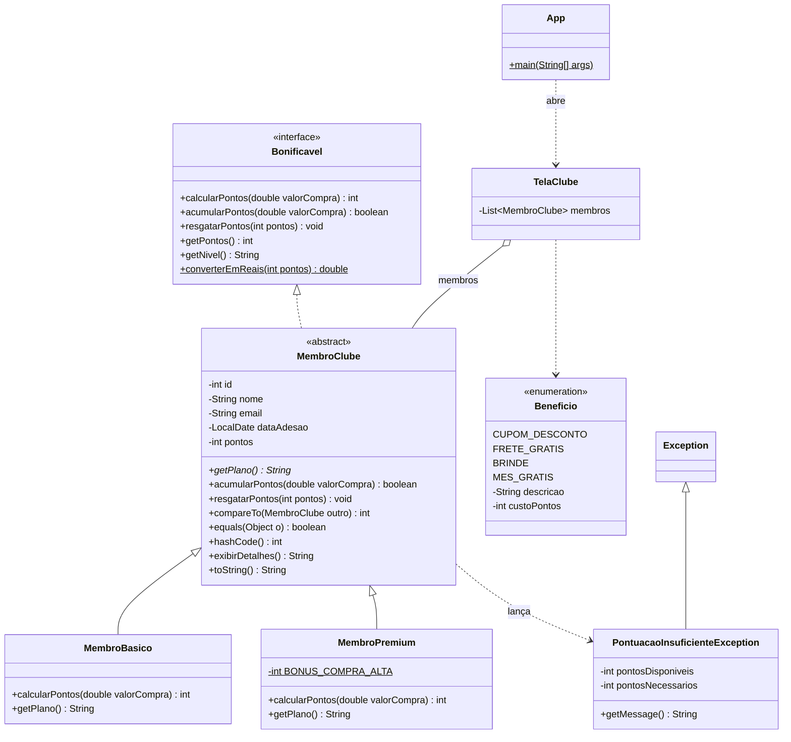
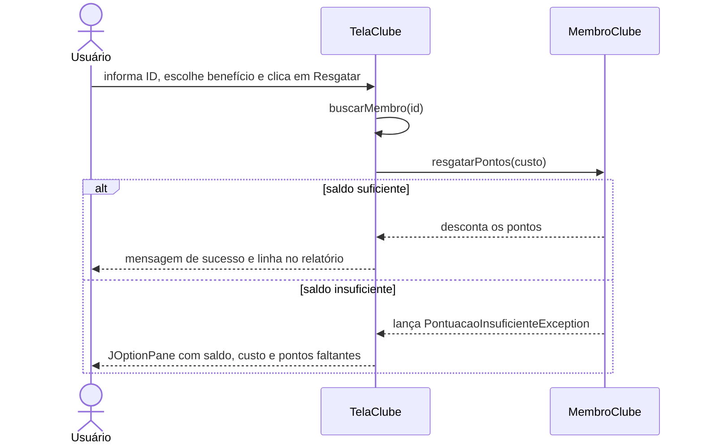

# Clube de Assinaturas e Fidelidade

Trabalho prático (P2) da disciplina de **Programação Orientada a Objetos**, Fatec Mogi Mirim.
Professor: Prof. Me. Marcos Roberto de Moraes (Maromo)

Sistema desktop em **Java Swing** para gerenciar os membros de um clube de fidelidade: adesão em um plano, acúmulo de pontos em compras, resgate de benefícios e ranking por pontuação.

## Sumário

- [Dupla](#dupla)
- [Tema escolhido](#tema-escolhido)
- [Tecnologias](#tecnologias)
- [Como executar](#como-executar)
- [Regras de negócio](#regras-de-negócio)
- [Arquitetura](#arquitetura)
- [Funcionalidades da tela](#funcionalidades-da-tela)
- [Validações e mensagens](#validações-e-mensagens)
- [Dados de exemplo](#dados-de-exemplo)
- [Conceitos de POO aplicados](#conceitos-de-poo-aplicados)
- [Requisitos atendidos](#requisitos-atendidos)
- [Limitações conhecidas](#limitações-conhecidas)
- [Uso de IA Generativa](#uso-de-ia-generativa)

## Dupla

- [@ayslan1234](https://github.com/ayslan1234)
- [@renatomota8855](https://github.com/renatomota8855)

## Tema escolhido

**Tema 07: Clube de Assinaturas e Fidelidade**

| Item pedido | Como ficou no projeto |
|---|---|
| Entidade principal (`Comparable`) | `MembroClube`, com ordenação natural pelo ID |
| Interface obrigatória | `Bonificavel`, com o método `resgatarPontos()` |
| Exceção customizada | `PontuacaoInsuficienteException` |
| Operações em memória | adesão ao clube, acúmulo de pontos, resgate de benefícios e ranking |

## Tecnologias

- **Java 21** (o projeto do IntelliJ usa o JDK `jbr-21`)
- **Swing** (`javax.swing`) para a interface gráfica
- Nenhuma biblioteca externa, banco de dados ou arquivo: tudo fica em memória

## Como executar

Primeiro, clone o repositório:

```bash
git clone https://github.com/ayslan1234/ProjetoClubeFidelidade.git
```

### Pelo IntelliJ IDEA

1. Abra a pasta `ProjetoClubeFidelidade` no IntelliJ.
2. Se for pedido, configure o JDK 21 em *File > Project Structure > Project SDK*.
3. Execute a classe `controller.App`.

### Pelo terminal

Dentro da pasta do projeto (onde está a pasta `src`):

```bash
javac -encoding UTF-8 -d out src/controller/*.java src/model/*.java src/interfaces/*.java src/exception/*.java src/view/*.java
java -cp out controller.App
```

A opção `-encoding UTF-8` é necessária porque os textos da tela têm acentos. A pasta `out/` já está no `.gitignore`.

## Regras de negócio

### Planos e pontuação

| Plano | Regra | Exemplo: compra de R$ 150,90 |
|---|---|---|
| **Básico** | 1 ponto a cada R$ 1,00 | 150 pontos |
| **Premium** | 2 pontos a cada R$ 1,00, mais 50 pontos de bônus em compras a partir de R$ 100,00 | 301 + 50 = 351 pontos |

Os centavos que não completam um ponto são descartados (a conversão para `int` trunca o valor).

### Níveis

O nível é calculado a partir do saldo atual de pontos e muda sozinho conforme o membro acumula ou resgata.

| Nível | Saldo |
|---|---|
| Bronze | até 499 pontos |
| Prata | de 500 a 999 pontos |
| Ouro | 1000 pontos ou mais |

Quando uma compra faz o membro mudar de nível, o relatório mostra um aviso (`*** Fulano subiu para o nível Prata! ***`).

### Valor dos pontos

Cada ponto vale **R$ 0,05**. O valor em reais aparece na ficha do membro e no total do ranking.

### Benefícios

| Benefício | Custo |
|---|---|
| Cupom de R$ 10,00 de desconto | 200 pts |
| Frete grátis no próximo pedido | 300 pts |
| Brinde exclusivo do clube | 500 pts |
| Um mês de assinatura grátis | 800 pts |

Se o saldo for menor que o custo, o resgate é recusado com a `PontuacaoInsuficienteException`, que informa o saldo, o custo e quantos pontos faltam.

## Arquitetura

### Pacotes

```
src/
├── controller/
│   └── App.java                            ponto de entrada (main)
├── model/
│   ├── MembroClube.java                    classe abstrata, entidade principal
│   ├── MembroBasico.java                   plano Básico
│   ├── MembroPremium.java                  plano Premium
│   └── Beneficio.java                      enum com os benefícios e seus custos
├── interfaces/
│   └── Bonificavel.java                    contrato do programa de pontos
├── exception/
│   └── PontuacaoInsuficienteException.java checked exception do resgate
└── view/
    └── TelaClube.java                      janela Swing e lista de membros
```

### Diagrama de classes



### Responsabilidades

**`Bonificavel`** (interface): define o que todo participante do programa de pontos precisa saber fazer: `calcularPontos()`, `acumularPontos()`, `resgatarPontos()` e `getPontos()`. Traz também o método `default getNivel()`, que calcula o nível a partir dos pontos, e o método `static converterEmReais()`.

**`MembroClube`** (classe abstrata): implementa `Bonificavel` e `Comparable<MembroClube>`. Guarda os dados comuns (ID, nome, e-mail, data de adesão e pontos) e implementa a lógica de acumular e resgatar. Deixa para as subclasses o `calcularPontos()` e o `getPlano()`.
- `compareTo()` ordena pelo ID, e é a ordem usada pelo `Collections.sort(membros)`.
- `equals()` e `hashCode()` comparam pelo ID, o que faz o `membros.contains(...)` impedir IDs repetidos.
- `toString()` devolve uma linha em colunas, usada nas listagens, e `exibirDetalhes()` devolve a ficha completa.

**`MembroBasico`** e **`MembroPremium`**: cada um implementa a sua regra em `calcularPontos()`. Como `acumularPontos()` chama `calcularPontos()`, a tela usa o mesmo código para os dois planos.

**`Beneficio`** (enum): lista os benefícios com descrição e custo. O `toString()` é o texto exibido no combo da tela.

**`PontuacaoInsuficienteException`**: herda de `Exception` (checked), então quem chama `resgatarPontos()` é obrigado a tratá-la. Guarda o saldo e o custo e monta a mensagem com quantos pontos faltam.

**`TelaClube`**: janela `JFrame` com layout nulo (posições fixas). Mantém a lista `List<MembroClube> membros = new ArrayList<>()`, trata os cliques com `ActionListener` e o fechamento da janela com `WindowListener`.

**`App`**: cria a `TelaClube` e a torna visível.

### Fluxo de um resgate



## Funcionalidades da tela

| Botão | O que faz | Campos usados |
|---|---|---|
| **Cadastrar** | Cria um membro no plano escolhido e registra a adesão no relatório. Não aceita ID repetido. | ID, Nome, E-mail, Plano |
| **Pesquisar** | Preenche os campos com os dados do membro e mostra a ficha completa no relatório. | ID |
| **Acumular** | Soma ao saldo os pontos da compra conforme o plano. Aceita `150,90` ou `150.90`. | ID, Valor da compra |
| **Resgatar** | Desconta o custo do benefício escolhido. | ID, Benefício |
| **Ordenar por ID** | Ordena a lista pela ordem natural (`compareTo`) e mostra todos os membros. | nenhum |
| **Ranking** | Ordena do maior para o menor saldo, mostra a posição de cada um e o total de pontos em circulação (em pontos e em reais). | nenhum |
| **Limpar** | Limpa os campos e o relatório. | nenhum |
| **Sair** | Pede confirmação e encerra o sistema. O botão X da janela faz o mesmo. | nenhum |

Exemplo da listagem do ranking:

```
============ RANKING POR PONTUAÇÃO ============
Pos  ID    Nome                 Plano     Pontos  Nível
 1º  105   Ana Souza            Premium      690  Prata
 2º  103   Diego Alves          Básico       540  Prata
 3º  110   Carla Mendes         Premium      190  Bronze
 4º  101   Bruno Lima           Básico       180  Bronze
Pontos em circulação: 1600 (R$ 80,00)
```

## Validações e mensagens

| Situação | Mensagem exibida |
|---|---|
| ID vazio ou não numérico | Erro: "ID inválido! Digite apenas números inteiros." (texto varia conforme a operação) |
| ID menor ou igual a zero no cadastro | Aviso: "O ID deve ser maior que zero." |
| Nome ou e-mail em branco | Aviso: "Preencha o nome e o e-mail do membro." |
| ID já cadastrado | Aviso: "Já existe um membro cadastrado com o ID ..." |
| ID não encontrado | Aviso: "Nenhum membro encontrado com o ID ..." |
| Valor da compra inválido | Erro: "ID ou valor da compra inválido! Use números (ex: 150,90)." |
| Valor da compra menor ou igual a zero | Aviso: "O valor da compra deve ser maior que zero." |
| Pontos insuficientes no resgate | Aviso com saldo atual, pontos necessários e pontos que faltam |
| Ordenar ou ranking com a lista vazia | Aviso: "Nenhum membro cadastrado." |

Os erros de conversão (`NumberFormatException`) são tratados com `try/catch` em cada operação, e todas as mensagens usam `JOptionPane`.

## Dados de exemplo

O sistema abre com quatro membros já cadastrados para facilitar os testes:

| ID | Nome | Plano | Compra inicial | Pontos | Nível |
|---|---|---|---|---|---|
| 101 | Bruno Lima | Básico | R$ 180,50 | 180 | Bronze |
| 103 | Diego Alves | Básico | R$ 540,00 | 540 | Prata |
| 105 | Ana Souza | Premium | R$ 320,00 | 690 | Prata |
| 110 | Carla Mendes | Premium | R$ 95,00 | 190 | Bronze |

Sugestões de teste:

- Resgatar o **Cupom** (200 pts) com o ID 110 para ver a exceção (saldo de 190 pts, faltam 10).
- Acumular R$ 160,00 no ID 105 para ver a Ana subir para o nível **Ouro** (690 + 320 + 50 = 1060 pts).
- Cadastrar um membro com o ID 101 para ver o bloqueio de ID repetido.

## Conceitos de POO aplicados

| Conceito | Onde aparece |
|---|---|
| Encapsulamento | Atributos `private` com getters e setters em `MembroClube`, `Beneficio` e na exceção |
| Herança | `MembroBasico` e `MembroPremium` herdam de `MembroClube`; a exceção herda de `Exception`; a tela herda de `JFrame` |
| Classe abstrata | `MembroClube`, que declara `getPlano()` como abstrato e deixa `calcularPontos()` (vindo da interface) para as subclasses |
| Polimorfismo | `acumularPontos()` chama o `calcularPontos()` de cada plano; o ranking soma os pontos percorrendo a lista como `Bonificavel` |
| Interface | `Bonificavel`, com método `default` (`getNivel()`) e `static` (`converterEmReais()`) |
| `Comparable` e `Comparator` | `compareTo()` por ID para a ordem natural; lambda `Comparator` por pontos no ranking |
| `equals()` e `hashCode()` | Por ID, usados pelo `contains()` para barrar IDs repetidos |
| Enum com atributos | `Beneficio`, com descrição e custo |
| Exceção checked customizada | `PontuacaoInsuficienteException`, tratada com `try/catch` na tela |
| Eventos | `ActionListener` para os botões e `WindowListener` para o fechamento da janela |

## Requisitos atendidos

- [x] Persistência 100% em memória com `List<MembroClube> membros = new ArrayList<>()`
- [x] Interface gráfica com `javax.swing` (`JFrame`, `JTextField`, `JLabel`, `JButton`, `JTextArea`/`JScrollPane`)
- [x] Eventos com `ActionListener` e fechamento da janela com `WindowListener`
- [x] Checked exception customizada (`PontuacaoInsuficienteException`) com mensagem via `JOptionPane`
- [x] Tratamento de `NumberFormatException` nos campos de ID e valor
- [x] Entidade principal com `Comparable<T>`, `compareTo()`, `equals()` e `hashCode()`
- [x] Ordenação com `Collections.sort()` (por ID e ranking por pontuação)
- [x] Interface de negócio com método `default` e `static`, implementada pelas classes do domínio

## Limitações conhecidas

- Os dados são perdidos ao fechar o programa, pois não há banco de dados nem arquivos (é um requisito do trabalho).
- Não há edição nem exclusão de membros. A classe tem `setNome()` e `setEmail()`, mas a tela não tem botão para alterar.
- O formato do e-mail não é validado, apenas se o campo está preenchido.
- Ordenar por ID ou gerar o ranking altera a ordem da própria lista em memória.

## Uso de IA Generativa

Seguindo a regra de transparência do trabalho, registramos abaixo o uso de IA no desenvolvimento.

**Ferramenta utilizada:** Claude (Anthropic)

### Prompt 1

**O que pedimos:** Examine o código feito e Melhore a interface "TelaClube" que está desalinhada e monte o README.

**Resposta obtida:** a IA escolheu alterou a interface e montou este README e testou a compilação e a tela.

**Como refinamos:** _(alteramos alguns texto que aparecem na interface)_

### Prompt 2

**O que pedimos:** fazer uma documentação bem feita para o projeto e tirar os comentários desnecessários do código.

**Resposta obtida:** a IA reescreveu este README (regras de negócio com exemplos, diagramas de classes e de sequência, tabela de validações, dados de exemplo e conceitos de POO aplicados). No código, removeu os comentários que só repetiam o que a linha já dizia e documentou as classes e os métodos principais com Javadoc. A lógica do programa não foi alterada.

**Como refinamos:** _(tiramos todos os textos desnecessários a conhecimento)_
